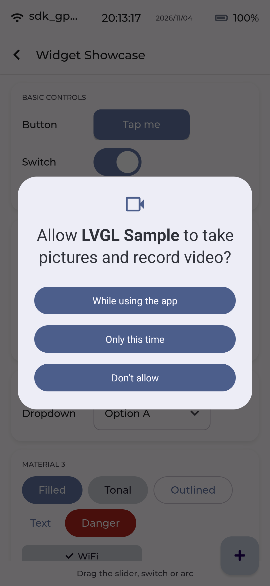
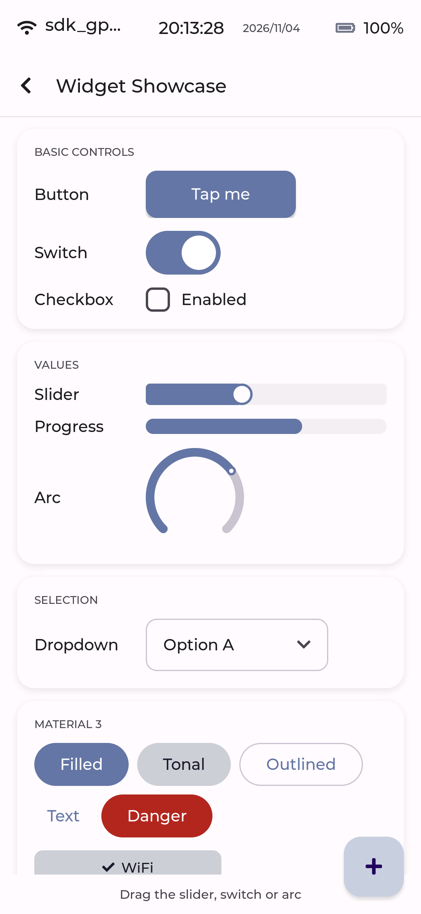
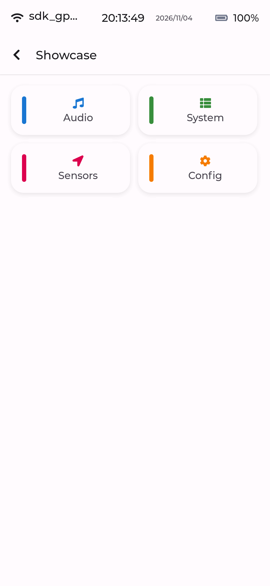
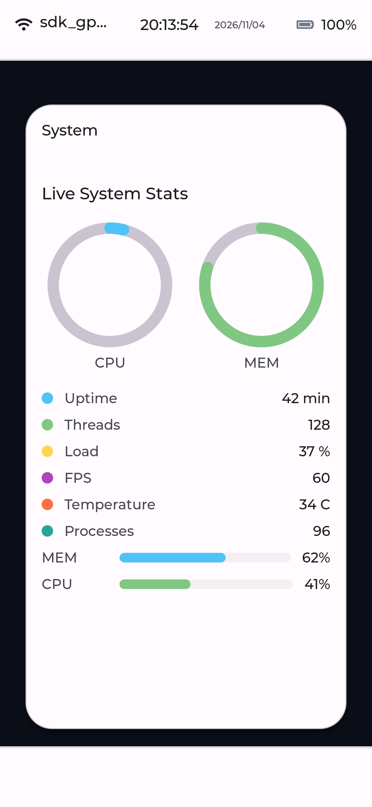
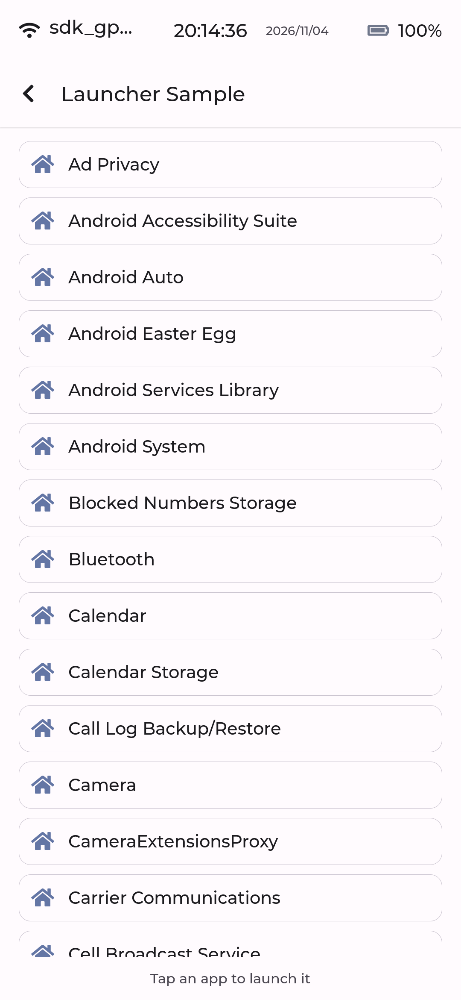
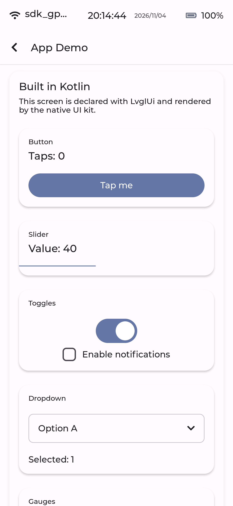
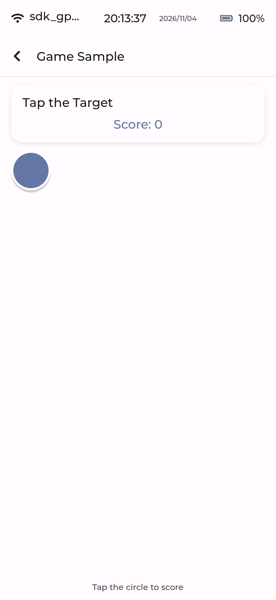
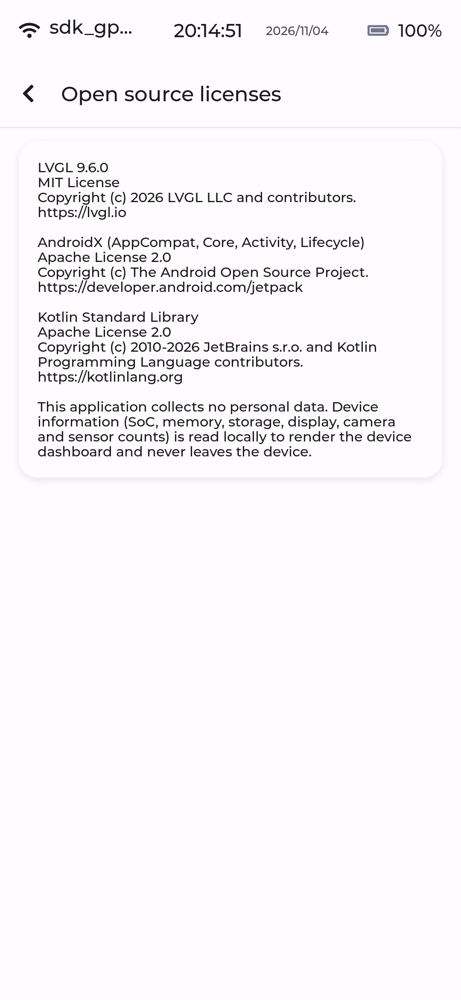

# LVGL Android Framework

[](https://github.com/lgstoian/lvgl-android/actions/workflows/ci.yml)
[](https://opensource.org/licenses/MIT)
[](https://github.com/lvgl/lvgl)

A framework for building small, efficient Android applications using [LVGL (Light and Versatile Graphics Library)](https://lvgl.io/) v9.6.0.

## Overview

This project transforms LVGL — a lightweight embedded GUI library — into a full Android framework. The framework provides Kotlin-first APIs for building Android apps with custom UI, including activities, input methods (keyboards), launchers, games, and apps with camera integration.

LVGL renders directly to an Android `SurfaceView` via native C code using JNI, providing a fully customizable UI without relying on Android's native widget system.

**Key Features:**
- LVGL v9.6.0 as a Git submodule for easy version updates
- Modular library (`lvgl-android`) + sample app architecture
- Kotlin-first API, including the `LvglUi` DSL for declaring app screens
- Material Design 3 theme integration with dark/light mode and Material You dynamic color
- Material 3 component kit (buttons, chips, FAB, cards, text field, bottom nav, dialog, snackbar, app bar) rendered natively on LVGL
- Kotlin UI builder: declare app screens with the `LvglUi` DSL and let the native UI kit render them
- Dynamic DPI adaptation and screen rotation handling
- Multiwindow and foldable device support
- Input Method Service (keyboard) support
- Launcher/home screen support
- Game-optimized activity with vsync
- Camera preview integration
- R/B pixel swap for correct RGBA rendering
- Dedicated LVGL render thread (vsync-aware, honours LVGL's requested period)
- Touch input with pointer gestures
- Spring-physics animation engine and animated window overlays
- M5Tab5-style device dashboard home: Android system schematic, floating control
  panels and a shared status bar (immersive)
- App Demo: a complete screen declared in Kotlin with the `LvglUi` DSL, plus a
  playable tap-the-target game demo
- Beautiful-by-default UI system: design tokens, a screen scaffold, overlap-proof
  layout primitives, text auto-fit and a layout lint with CI reporting
- Developer toolkit: quickstart, public API reference, copyable `template/`, a
  `com.lvgl.android.app` Gradle scaffolding plugin and a binary-compatibility API dump
- Google Play ready: target API 36, 64-bit, AAB, runtime permissions, privacy
  policy and in-app licence disclosure
- Space-efficient releases: R8 full mode, resource shrinking, per-ABI splits and the
  static C++ STL — ~1.3 MB per ABI, ~2.1 MB universal

## Module Structure

```
android_lvgl/
├── lvgl/                       # Git submodule (LVGL v9.6.0 source)
│   ├── include/lvgl/           # Public headers
│   └── src/                    # Implementation files
├── lvgl-android/               # Framework library module
│   ├── src/main/
│   │   ├── java/com/lvgl/android/
│   │   │   ├── engine/         # LvglEngine (singleton rendering engine)
│   │   │   ├── view/           # LvglSurfaceView, LvglSurfaceViewWithGestures
│   │   │   ├── activity/       # LvglActivity base class, accessibility ext
│   │   │   ├── config/         # DpiManager, DisplayMetricsManager, ConfigurationManager
│   │   │   ├── theme/          # MaterialTheme, MaterialPalette, LvglThemeBridge
│   │   │   ├── window/         # MultiWindowManager
│   │   │   ├── input/          # LvglInputMethodService, LvglInputProcessor, gestures
│   │   │   ├── launcher/       # LvglLauncherActivity, LauncherAppListener
│   │   │   ├── game/           # LvglGameActivity
│   │   │   ├── camera/         # LvglCameraPreview
│   │   │   ├── navigation/     # LvglNavigation (screen back stack)
│   │   │   ├── accessibility/  # LvglAccessibilityManager, focus navigation, screen reader
│   │   │   ├── perf/           # LvglPerformanceMonitor
│   │   │   ├── system/         # LvglSystemControl, LvglDeviceInfo
│   │   │   ├── ui/             # LvglUi DSL, nodes, events, JSON wire format
│   │   │   └── util/           # LvglLog
│   │   └── cpp/                # Native code (CMake): port, demo UI, animation, windows, app screens
│   │       └── api/            # Binary-compatibility API dump (apiCheck)
├── app/                        # Sample application
│   ├── src/main/
│   │   ├── java/com/lvgl/sample/
│   │   │   ├── *.kt            # Dashboard + widget/layout/interactive/camera/game/launcher samples
│   │   │   └── showcase/       # DemoShowcaseActivity (spring-physics demo)
│   │   └── res/
│   └── build.gradle.kts
├── build-logic/                # Included Gradle build: com.lvgl.android.app plugin
├── template/                   # Copyable standalone app project (composite build)
├── docs/                       # Quickstart, public API, breadcrumb trail, schema
├── lvgl-android/api/           # Binary-compatibility API dump (apiCheck)
├── tools/                      # Dynamic (emulator) harness + size report
├── screenshots/                # Screenshots for documentation
├── build.gradle.kts            # Root build config
├── settings.gradle.kts         # Gradle settings (includes :app, :lvgl-android)
├── ai-context.md               # Known issues and quirks
├── AGENTS.md                   # Development guide
├── BUILDING.md                 # Quick start guide
└── README.md                   # This file
```

## Requirements

- Android SDK (API 24+)
- Android NDK r26b or compatible
- JDK 17+
- CMake 3.22.1+ (with `share/cmake-X.Y` directory)
- Gradle 8.5+

## Environment Setup

```powershell
$env:JAVA_HOME = "C:\Users\lgstoian\jdk-17\jdk-17.0.12"
$env:ANDROID_HOME = "D:\ASDK"
```

## Building

```powershell
# Set environment
$env:JAVA_HOME = "C:\Users\lgstoian\jdk-17\jdk-17.0.12"
$env:ANDROID_HOME = "D:\ASDK"

# Build
cd "D:\Code\android lvgl"
.\gradlew.bat assembleDebug --no-daemon
```

APK: `app/build/outputs/apk/debug/app-universal-debug.apk`
(per-ABI APKs are also produced: `app-arm64-v8a-debug.apk`, `app-x86_64-debug.apk`)

## Demos

| Device dashboard | Widget showcase |
| --- | --- |
|  |  |

| Spring-physics showcase | Showcase window |
| --- | --- |
|  |  |

| Launcher (real app grid) | App demo (Kotlin `LvglUi` screen) |
| --- | --- |
|  |  |

| Game sample | Open source licenses |
| --- | --- |
|  |  |

## Build a new app

The fastest path is the copyable template:

```powershell
# Copy template/ next to the framework checkout, then build and run.
Copy-Item -Recurse template C:\src\MyLvglApp
cd C:\src\MyLvglApp
& "..\android lvgl\gradlew.bat" :app:assembleDebug
```

Or scaffold a module in place with the Gradle plugin:

```kotlin
// settings.gradle.kts
pluginManagement { includeBuild("build-logic") }

// build.gradle.kts
plugins { id("com.lvgl.android.app") }
lvglApp { moduleName = "myapp"; packageName = "com.example.myapp" }
```

```powershell
.\gradlew.bat createLvglApp
```

See [docs/quickstart.md](docs/quickstart.md) for the full walkthrough and
[docs/public-api.md](docs/public-api.md) for the API reference.

## Size

Release APKs are split per ABI and minified:

```powershell
.\gradlew.bat assembleRelease
pwsh tools/size-report.ps1
```

| artefact | size |
| --- | --- |
| `app-arm64-v8a-release.apk` | ~1.3 MB |
| `app-x86_64-release.apk` | ~1.3 MB |
| `app-universal-release.apk` | ~2.1 MB |

The budget (4 MB per ABI, 6 MB universal) is enforced in CI.

## Architecture

### Framework Layers

```
┌─────────────────────────────────────────┐
│   Sample Apps (Activity, IME, Launcher)  │
├─────────────────────────────────────────┤
│   Kotlin Framework (LvglActivity, etc.)  │
├─────────────────────────────────────────┤
│   JNI Bridge (nativeCreate, etc.)       │
├─────────────────────────────────────────┤
│   C++ Native (Engine, rendering, input)  │
├─────────────────────────────────────────┤
│   LVGL 9.6.0 (core, widgets, themes)    │
└─────────────────────────────────────────┘
```

### Rendering Pipeline

1. LVGL renders widgets into a framebuffer in memory
2. The flush callback (C++) copies the framebuffer to an `ANativeWindow`
3. Pixel format conversion (BGRA → RGBA) is performed during copy
4. `ANativeWindow_unlockAndPost()` presents the frame

### Threading Model

- LVGL `LvglEngine` is a Kotlin singleton managing display lifecycle
- Native C++ `Engine` struct holds native state (window, display, framebuffers, threads)
- `nativeCreate`/`nativeDestroy` manage the native engine lifecycle via JNI
- Dedicated LVGL thread runs `lv_timer_handler()`, honouring the period LVGL
  requests (capped at ~16 ms) so animations stay vsync-aware
- Touch events propagate from Kotlin UI thread to native via JNI

### Material Theme Integration

- `MaterialPalette` defines the 20 Material 3 tonal roles in a fixed index order
  shared with the native `MaterialRole` enum.
- `MaterialTheme` resolves the palette from the baseline scheme or the Android
  system accents (Material You, API 31+) and follows the system dark/light mode.
  The dashboard theme FAB can pin an app-local dark-mode override.
- `LvglActivity` registers theme change listeners; `LvglThemeBridge` pushes the
  palette to native, which rebuilds the current screen.
- Every native component reads `ui_palette()`, so a whole app re-themes by
  construction.

### Material 3 component kit

`demo_ui.h` exposes a native component kit that renders Material 3 from the
palette, so apps look and behave natively while staying pure LVGL:

- `ui_make_button` — filled / tonal / outlined / text, plus a danger variant.
- `ui_make_chip`, `ui_make_fab`, `ui_make_m3_card` (filled/elevated/outlined).
- `ui_make_text_field`, `ui_make_divider`, `ui_make_bottom_nav`.
- `ui_make_dialog`, `ui_make_snackbar` — floating overlays with a scrim and
  auto-dismiss.
- `ui_make_app_bar` — the M3 top app bar used by the screen scaffold.

The widget showcase's `MATERIAL 3` section demonstrates every component.

### Kotlin UI builder

`LvglUi` lets an app declare its own screens in Kotlin instead of picking one of
the built-in ones. The tree is rendered by the native UI kit, so it shares the
Material 3 palette, the layout lint and the event bridge:

```kotlin
LvglUi.registerScreen(1000, title = "Hello") {
    column {
        label("Hello from Kotlin!", sizeDp = 20)
        button("Tap me", fillWidth = true, id = "tap") {
            LvglUi.updateNode(1000, "status", text = "Tapped!")
        }
        label("Tapped!", id = "status", sizeDp = 16)
    }
}
```

App screen ids start at `LvglUi.APP_SCREEN_BASE` (1000); `0..7` are built in.
`LvglEngine.initialize()` reports a missing native library through
`nativeLoadError` instead of crashing.

### Device Dashboard (home screen)

The entry screen (`SCREEN_HOME`) is a phone outline filled with the components
actually detected on the device, inspired by the M5Tab5 user demo:

- The map shows the real SoC, RAM, storage, display, camera and sensor counts
  (`LvglDeviceInfo`), drawn with LVGL primitives and scaled to portrait and
  landscape.
- LCD backlight and speaker volume panels drive real Android APIs through the
  `ScreenNavigator` bridge; power/RTC/peripheral panels are visual.
- Every screen shares the status bar (Wi-Fi, live clock, battery), and the app
  runs immersive so it does not duplicate the Android system bar.

### Beautiful-by-default UI system

New screens are consistent and correctly aligned without hand-tuning:

- `ui_tokens()` — spacing/radius/type scales; never hard-code a dp value.
- `ui_make_scaffold(parent, title, show_back)` — status bar + header + body.
- `ui_make_row/column/grid/card/section/list_row` — every container sets a flex
  layout, gap and alignment, so children cannot pile up at (0,0).
- `ui_fit_label()` — shrinks text to fit its box instead of clipping.
- `ui_layout_check()` / `LvglEngine.dumpLayoutReport()` — a lint that reports
  overlapping siblings, out-of-bounds children and clipped text; the dynamic
  harness fails CI when any warning appears.

## Updating LVGL Version

LVGL is a Git submodule:

```powershell
cd lvgl
git fetch --tags
git checkout v9.7.0  # Change to desired version
cd ..
git add lvgl
git commit -m "Update LVGL to v9.7.0"
```

After updating, check for:
- New config options in `lv_conf.h`
- New/deprecated APIs in `lvgl/src/**/*.c`
- New function signatures in `include/lvgl/**/*.h`

## Documentation

- [AGENTS.md](AGENTS.md) — Development guide and troubleshooting (read before coding)
- [ai-context.md](ai-context.md) — Known issues, quirks, and fixes
- [docs/quickstart.md](docs/quickstart.md) — Your first LVGL Android app in 5 minutes
- [docs/public-api.md](docs/public-api.md) — Public API reference
- [template/README.md](template/README.md) — Copyable app template
- [build-logic/README.md](build-logic/README.md) — `com.lvgl.android.app` scaffolding plugin
- [docs/agent-comment-schema.md](docs/agent-comment-schema.md) — Machine-readable comment schema
- [docs/agent-breadcrumbs.json](docs/agent-breadcrumbs.json) — Decision trail for AI agents
- [BUILDING.md](BUILDING.md) — Quick start guide
- [ROADMAP.md](ROADMAP.md) — Development roadmap and progress
- [CHANGELOG.md](CHANGELOG.md) — Release notes
- [PRIVACY.md](PRIVACY.md) — Privacy policy (no personal data collected)
- [docs/play-store.md](docs/play-store.md) — Google Play readiness checklist

## License

This project is licensed under the MIT License. See [LICENSE](LICENSE) for the full text.

### Third-Party Software

This project uses [LVGL](https://lvgl.io) v9.6.0, which is also MIT licensed. See [THIRD_PARTY_NOTICES.md](THIRD_PARTY_NOTICES.md) for a complete list of attributions.
